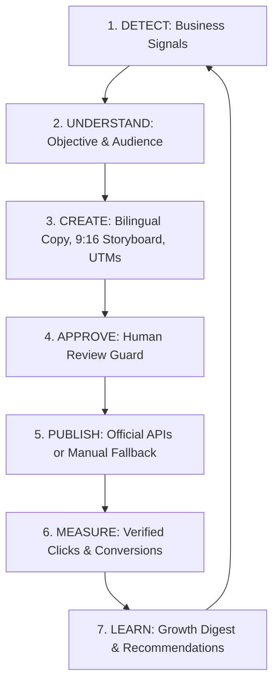

# AutoBuzz — Marketing Operating System

> **Tagline:** Create. Automate. Grow.  
> **Official Repository:** [https://github.com/istihadahmed007/AutoBuzz](https://github.com/istihadahmed007/AutoBuzz)  
> **Live Production Deployment:** [https://istihadahmed007.github.io/AutoBuzz/](https://istihadahmed007.github.io/AutoBuzz/)

---

## 1. Product Concept: The Signal-to-Story Marketing Engine

AutoBuzz is an original, AI-powered marketing operating system designed to eliminate empty social calendars and disconnected marketing tasks. Instead of guessing what to post, AutoBuzz continuously listens for **business signals**—such as a new product arrival, a website launch, a recurring customer question, a search ranking opportunity, or a high-value lead inquiry—and transforms each observation into a cohesive, measurable marketing campaign.

### The Core Operational Loop


1. **Detect**: Ingest real events from website updates, CRM forms, search consoles, or manual observation.
2. **Understand**: Infer campaign objective (Acquisition, Activation, Retention, Thought Leadership) and optimal distribution channels.
3. **Create**: Synthesize bilingual English and Bangla narrative copy, four-scene vertical video storyboards (9:16 Shorts/Reels/TikTok), and campaign tracking links.
4. **Approve**: Enforce a mandatory human approval workflow before any post is scheduled or published publicly.
5. **Publish**: Dispatch to official platform APIs (Meta Graph API, YouTube Data API, TikTok Content Posting) with idempotency deduplication guards and fallback manual checklists.
6. **Measure**: Track genuine UTM campaign clicks, form submissions, and verified conversions.
7. **Learn**: Generate executive growth digests and tactical recommendations informed strictly by real data.

---

## 2. Platform Architecture & The 17 Canonical Modules

AutoBuzz features a dual-surface, free-first architecture:
- **Client Application (`index.html`)**: A responsive, ice-blue (`#58C4E8`) and deep-navy (`#0C2333`) SaaS web application deployed to GitHub Pages with instant page loads, reactive modals, interactive drawers, and zero external runtime lock-in.
- **Backend & Execution Services (`src/services/`)**: TypeScript business logic for signal ingestion, workflow graph simulation, idempotency verification, and SEO intelligence.
- **Database Architecture (`supabase/migrations/`)**: PostgreSQL schema with Row-Level Security (RLS), audit logs, and trigger rules.

### The 17 Complete Platform Modules
| # | Module | Description & Capabilities |
|---|--------|----------------------------|
| 1 | **Marketing Command Center** | Real-time platform pulse, active campaign progress, pipeline health, and quick actions. |
| 2 | **Signal Inbox** | Central ingestion hub for business triggers (products, FAQs, SEO opportunities, leads). |
| 3 | **AI Story Builder** | Generates 3-act narrative arcs, bilingual captions (EN/BN), hashtags, and trackable links. |
| 4 | **Campaign Experiments** | Structured A/B growth testing with documented hypotheses, metric targets, and evaluation notes. |
| 5 | **Content Studio** | Multi-channel content editor supporting Facebook, Instagram, LinkedIn, and blog drafts. |
| 6 | **Social Media Calendar** | Visual schedule differentiating drafts, approved, queued, published, and failed posts. |
| 7 | **Short-form Video Studio** | 9:16 vertical video storyboarder (Hook, Problem, Solution, CTA) with Bangla and English scripts. |
| 8 | **Connected Social Accounts** | Official OAuth account manager for Meta, YouTube, and TikTok with connection health checks. |
| 9 | **SEO Intelligence** | Search query radar, on-page title/meta optimizer with approval guards, and broken link scanner. |
| 10 | **Lead Management & CRM** | Inbound lead tracker with consent logs, UTM source attribution, stages, and follow-up tasks. |
| 11 | **Email Marketing** | Automated lead onboarding emails, product launch sequences, and unsubscription preference guards. |
| 12 | **Visual Automation Builder** | Workflow engine executing triggers, conditions, delays, and actions (Workflows A through F). |
| 13 | **Campaign Analytics** | UTM campaign attribution radar tracking clicks, verified conversions, and channel performance. |
| 14 | **Reports & Recommendations** | Executive Growth Digest and actionable growth playbooks informed by verified outcomes. |
| 15 | **Integrations Hub** | Honest connection manager for Meta, YouTube, TikTok, Google Analytics, Search Console, and Resend. |
| 16 | **Notifications Center** | Real-time alerts for workflow completions, pending approvals, and system diagnostics. |
| 17 | **Security & Settings** | Role-based access control (RBAC), API key management, audit logs, and data retention policies. |

---

## 3. Visual Automation Engine: Workflows A through F

AutoBuzz includes six production-tested workflow templates ready for deployment:

- **Workflow A (Website Launch Campaign)**: Detects a website publication signal, generates bilingual social packs, and queues them for human approval.
- **Workflow B (Inbound Lead Capture & Qualification)**: Validates web forms, records consent, tags UTM source, and assigns follow-up tasks.
- **Workflow C (Smart Lead Follow-Up Sequence)**: Automatically sends introductory emails with strict unsubscribe and opt-out checks.
- **Workflow D (SEO Performance & Indexing Radar)**: Monitors impressions and clicks, suggesting title/meta enhancements for editorial review.
- **Workflow E (Executive Growth Digest)**: Scheduled Monday morning cron summarizing verified campaign performance.
- **Workflow F (Diagnostic Logging & Error Recovery)**: Detects failed API calls, logs errors, and executes safe backoff retries.

---

## 4. Trust-First Telemetry: No Fake Metrics Policy

AutoBuzz enforces strict data integrity:
- **No Mock Visitors or Fabricated Revenue**: If Google Analytics 4 or Search Console is disconnected, the platform displays an honest "Disconnected" status with setup instructions—never simulated numbers.
- **No Fake "Published" States**: Scheduled posts remain marked as "Scheduled" or "Draft" until the external API confirms successful publishing.
- **Mandatory Approval Guards**: No public social post or email blast can be triggered automatically unless explicitly approved by an administrator.

---

## 5. Local Setup & Testing

### Prerequisites
- Node.js 18+ (Node 20+ recommended)
- Git

### Installation
```bash
# Clone the official repository
git clone https://github.com/istihadahmed007/AutoBuzz.git
cd AutoBuzz

# Install dependencies
npm install

# Copy environment template
cp .env.example .env
```

### Running Unit & Integration Tests
The repository includes a comprehensive Vitest test suite testing the Signal-to-Story Engine, Automation Runner, Social Publisher, and SEO Intelligence:
```bash
npx vitest run tests/autobuzz.test.ts
```
**Test Results:**
```text
✓ tests/autobuzz.test.ts (9 tests)
  ✓ Signal Engine > should convert a product launch signal into a structured campaign story
  ✓ Signal Engine > should generate bilingual narrative copy (English and Bangla)
  ✓ Signal Engine > should create a 4-scene vertical video storyboard (9:16)
  ✓ Automation Runner > should validate workflow graph without circular dependency
  ✓ Automation Runner > should simulate Workflow A execution successfully
  ✓ Automation Runner > should halt Workflow C if lead has unsubscribed
  ✓ Social Publisher > should prevent duplicate publishing using idempotency key
  ✓ Social Publisher > should format honest manual publishing instructions when API disconnected
  ✓ SEO Intelligence > should recommend meta title and description with character limits

Test Files  1 passed (1)
Tests       9 passed (9)
```

---

## 6. Production Deployment

AutoBuzz is automatically built and deployed to GitHub Pages on every push to the `main` branch via GitHub Actions (`.github/workflows/pages.yml`).

- **Live URL:** [https://istihadahmed007.github.io/AutoBuzz/](https://istihadahmed007.github.io/AutoBuzz/)
- **Target Hosting:** GitHub Pages (Frontend) + Supabase (PostgreSQL Database & Auth) + Self-hosted n8n (Optional Workflow Runner).

---

## 7. License & Credits

Built with pride by the AutoBuzz team.  
*Create. Automate. Grow.*
